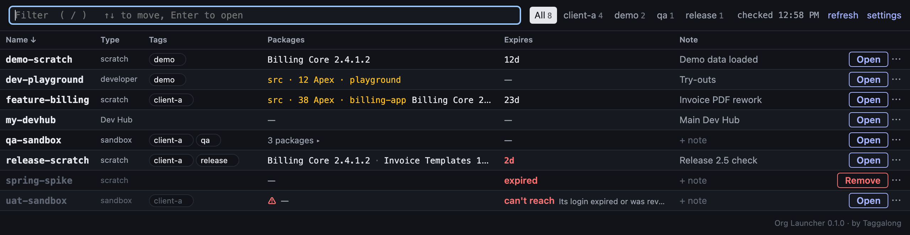

# Org Launcher

One fast, keyboard-first table of every Salesforce org your sf CLI knows.



## Install

You need the [Salesforce CLI](https://developer.salesforce.com/tools/salesforcecli) (`sf`) with Node.js 22 or later.

```sh
sf plugins install @taggalongtech/org-launcher
```

The sf CLI then says the plugin isn't signed by Salesforce and asks whether to continue. Answer `y`. Only
Salesforce can sign sf CLI plugins, so every plugin from anyone else asks this. To skip the question on
later installs and updates, add the plugin to the sf CLI's allow list, `~/.config/sf/unsignedPluginAllowList.json`:

```json
["@taggalongtech/org-launcher"]
```

## Open it

```sh
sf launcher
```

This starts a small server in the background and opens the page at http://localhost:4242. Every org you've logged in to with the sf CLI is there. You don't add them by hand.

The first time you run it in a terminal, it asks two questions: keep Org Launcher running at login, and, on macOS, add it to the Dock. Say no and nothing is set up. You can add either one later.

Type to filter. Press `/` to jump to the filter, the arrow keys to move, and Enter to open the selected org.

## What a row shows

- **Name:** the org's alias. Hover it to see the username, other aliases and the Dev Hub.
- **Type:** scratch, sandbox, Dev Hub, production or developer.
- **Tags:** your own labels. Click one to see only orgs with that tag. The tabs at the top do the same.
- **Packages:** installed packages and their versions. Packages Salesforce installs itself are left out. When an org holds Apex outside any package, you see `src · 38 Apex` in amber. If you ran `sf launcher` from the project that deployed it, the project's name follows.
- **Expires:** days left for a scratch org. It turns red at 3 days or fewer. An expired scratch org says "expired" and offers Remove. An org that can't be checked says "can't reach" with a one-line reason, like an expired login. An org that answers but won't show its main login everything says "limited access": make an admin login the main login from the ⋯ menu.
- **Note:** a short note. Click it to edit.
- **Open** logs you in to the org in your browser. The `⋯` menu has the rest: pick the main login when an org has more than one, choose a browser for this org, hide the row, or remove the org's logins from this computer (this runs `sf org logout`).

The page shows what it knew last time right away. It then checks each org in the background, 6 at a time, and again every 10 minutes. Each check is three read-only queries. Click **refresh** to check now.

## Tags and notes from scripts

You can set tags and notes from the command line. That's handy right after you create a scratch org. The server doesn't need to be running.

```sh
sf org create scratch --alias feature-billing --definition-file config/project-scratch-def.json
sf launcher tag feature-billing client-a demo     # add tags
sf launcher tag feature-billing --remove demo     # remove a tag
sf launcher tag feature-billing --set client-a --set release   # keep only these tags
sf launcher tag feature-billing                   # just print the tags and note
sf launcher note feature-billing "Invoice PDF rework"
sf launcher note feature-billing ""               # clear the note
```

Name the org like `-o` does: an alias, a username or an org id. Tags are lowercase letters, numbers, dot, dash or underscore, up to 32 characters, and up to 10 per org. A note is up to 500 characters. Add `--json` for output a script can read. An open page shows the change when you switch back to it.

## Open orgs in a browser profile

By default, orgs open in your system's default browser. Click **settings** to change that:

- **Open orgs in:** one browser and profile for every org.
- **By tag:** orgs with a tag open in their own browser and profile. Keep client orgs in a client profile, for example.
- **Open in…** in a row's `⋯` menu sets a browser for that org only.

The org's own choice wins. Next comes the first of its tags with a rule, then the choice for every org.

Org Launcher knows Chrome, Edge, Brave and Firefox. Chrome, Edge and Brave name profiles "Default" or "Profile" and a number, like "Profile 3". To find yours, open `chrome://version` in that profile and look at the last part of Profile Path. For Firefox, use the profile's name.

## Start at login and the Dock app

```sh
sf launcher start --at-login   # start now, and at every login
sf launcher dock               # macOS: add Org Launcher to the Dock
sf launcher dock --remove      # unpin the Dock app and delete it
sf launcher status             # is it running, and where
sf launcher stop               # stop the server
```

Nothing is set up at install. Org Launcher only starts at login after you say yes at the first `sf launcher`, or run `start --at-login`.

- **macOS:** a LaunchAgent in `~/Library/LaunchAgents`.
- **Linux:** a systemd user service, `~/.config/systemd/user/org-launcher.service`.
- **Windows:** a Task Scheduler task named "Org Launcher". Creating it may need a terminal run as administrator. A console window may show when it starts.

The login service restarts the server if it fails, but not after a clean stop. When the sf CLI updates itself, the next `sf launcher` points the login service at the new version without asking again.

The login service belongs to the folder it was set up from. With `ORG_LAUNCHER_HOME` set to another folder, the commands leave it alone. On Windows the task can't record its folder, so every folder treats it as its own.

The Dock app lives in the Applications folder in your home folder. It opens the page as its own window in the browser you chose for every org, if that's Chrome, Edge or Brave. Otherwise it opens a tab in your default browser. If Org Launcher isn't running, the Dock app starts it through the login service. Without one, it says to run `sf launcher`.

The page uses port 4242. If another program has it, pick another port. It's saved for every later start:

```sh
sf launcher start --port 4343
```

## Privacy

- **Your logins stay where the sf CLI keeps them.** The local server reads them in memory through `@salesforce/core`, the sf CLI's own library. Org Launcher never writes a token or login link to disk, never logs one, and never sends one to the page.
- **The page only answers this computer.** The server listens on 127.0.0.1 only. It refuses requests addressed to any other host name, and changes sent from any other web page.
- **No tracking.** No telemetry, analytics or update checks. The only network calls go to your own orgs.

What Org Launcher saves lives in `~/.sf/org-launcher`: your tags, notes and settings, the project folders you ran `sf launcher` from, the last check of each org (its type, packages and Apex count), and a server log with the method and path of each request. The log is kept under 1 MB, plus one older copy. Set `ORG_LAUNCHER_HOME` to use another folder.

## Platforms

macOS is fully supported. Windows and Linux are early: the tests pass there, but they've had less use. Please [open an issue](https://github.com/TaggalongTech/org-launcher/issues) when something doesn't work.

## Uninstall

Remove the login service and the Dock app first, then the plugin:

```sh
sf launcher uninstall
sf plugins uninstall @taggalongtech/org-launcher
```

`sf launcher uninstall` keeps your tags, notes and settings. Add `--purge` to delete them too.

## License

[MIT](LICENSE)

Built by [Taggalong](https://taggalong.com/accelerators).
